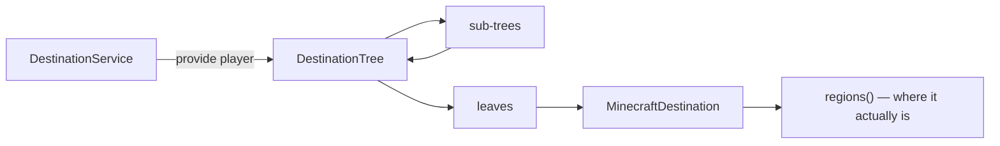

# Destinations

A **destination** is a named location that `/navigate` can route to. Destinations are supplied by a
`DestinationService`, which is queried per player, per search.

## Structure



## Minimal example

A single destination at a fixed location:

=== "Paper"

    ```java
    import org.cobblestonemc.paper.plugin.api.CobblestonePaperApi;
    import org.cobblestonemc.paper.plugin.api.Destination;
    import org.cobblestonemc.paper.plugin.api.DestinationService;
    import org.cobblestonemc.paper.plugin.api.DestinationTree;

    public final class ShopsPlugin extends JavaPlugin {
      @Override
      public void onEnable() {
        CobblestonePaperApi.registrar().registerDestinations(this, player ->
            DestinationTree.builder()
                .leaf("market", () -> Destination.at(marketLocation(), "Market"))
                .build());
      }
    }
    ```

=== "Sponge"

    ```java
    import net.kyori.adventure.text.Component;
    import org.cobblestonemc.sponge.plugin.api.CobblestoneSpongeApi;
    import org.cobblestonemc.sponge.plugin.api.Destination;
    import org.cobblestonemc.sponge.plugin.api.DestinationService;
    import org.cobblestonemc.sponge.plugin.api.DestinationTree;

    @Listener
    public void onStartedEngine(StartedEngineEvent<Server> event) {
      CobblestoneSpongeApi.registrar().registerDestinations(container, player ->
          DestinationTree.builder()
              .leaf("market", () -> Destination.at(marketLocation(), Component.text("Market")))
              .build());
    }
    ```

For a plugin named `Shops`, the address is `shops market`. Players may use `/nav market`, or
`/nav shops market` if the name is ambiguous.

!!! note

    The tree is already registered under the owner plugin's name. Do not add a top-level node for
    it.

## Trees

`DestinationTree.builder()` creates leaves and subtrees, each keyed by a string:

=== "Paper"

    ``` { .java .annotate }
    DestinationTree.builder()
        .subtree("warp", () -> warps(player))
        .subtree("dungeon", DestinationTree.builder()
            .strict()                                     // (1)!
            .leaf("crypt", () -> Destination.at(crypt, "The Crypt"))
            .leaf("mines", () -> Destination.at(mines, "Deep Mines"))
            .build())
        .build();
    ```

    1. A strict level cannot be omitted: `/nav dungeon crypt` is valid; `/nav crypt` is not.

=== "Sponge"

    ``` { .java .annotate }
    DestinationTree.builder()
        .subtree("warp", () -> warps(player))
        .subtree("dungeon", DestinationTree.builder()
            .strict()                                     // (1)!
            .leaf("crypt", () -> Destination.at(crypt, Component.text("The Crypt")))
            .leaf("mines", () -> Destination.at(mines, Component.text("Deep Mines")))
            .build())
        .build();
    ```

    1. A strict level cannot be omitted: `/nav dungeon crypt` is valid; `/nav crypt` is not.

Rules:

- **Keys** are single tokens. Upper case is permitted; special characters are not. Spaces are
  permitted but discouraged, since keys appear in commands and permission nodes.
- **Children are suppliers**, evaluated only when traversed.
- **Return `null`** from `provide` when there are no destinations for the player. Empty trees are
  omitted.
- **Mark large levels `strict()`.** Strict levels are skipped when computing suggestions.

### Lazy levels

=== "Paper"

    ```java
    private PlatformDestinationTree<World, Vector3i> warps(Player player) {
      DestinationTree tree = DestinationTree.builder().strict();
      for (Warp warp : store.visibleTo(player)) {
        // The lambda body runs only if this leaf is actually traversed.
        tree.leaf(warp.name(), () -> Destination.at(warp.location(), warp.name()));
      }
      return tree.build();
    }
    ```

=== "Sponge"

    ```java
    private PlatformDestinationTree<ServerWorld, Vector3i> warps(ServerPlayer player) {
      DestinationTree tree = DestinationTree.builder().strict();
      for (Warp warp : store.visibleTo(player)) {
        // The lambda body runs only if this leaf is actually traversed.
        tree.leaf(warp.name(), () -> Destination.at(warp.location(), Component.text(warp.name())));
      }
      return tree.build();
    }
    ```

## Destination types

`Destination` provides factories for common cases:

=== "Paper"

    ```java
    // A single block. Its coordinates are shown on hover.
    Destination.at(location, "Market");

    // Anywhere in one region.
    Destination.region(BoxWorldRegion.of(corner1, corner2), "The Arena");
    Destination.region(BoxWorldRegion.around(center, 8), "Near the well");
    Destination.region(WholeWorldRegion.of(world), "The Nether");

    // Several regions — the search heads for whichever is cheapest to reach, and
    // the supplier is re-evaluated every search, so a moving target stays current.
    Destination.regions(() -> town.claims().stream().map(this::toRegion).toList(), "Riverwood");
    ```

=== "Sponge"

    ```java
    // A single block. Its coordinates are shown on hover.
    Destination.at(location, Component.text("Market"));

    // Anywhere in one region.
    Destination.region(BoxWorldRegion.of(corner1, corner2), Component.text("The Arena"));
    Destination.region(BoxWorldRegion.around(center, 8), Component.text("Near the well"));
    Destination.region(WholeWorldRegion.of(world), Component.text("The Nether"));

    // Several regions — the search heads for whichever is cheapest to reach, and
    // the supplier is re-evaluated every search, so a moving target stays current.
    Destination.regions(
        () -> town.claims().stream().map(this::toRegion).toList(), Component.text("Riverwood"));
    ```

A destination with no regions is valid and unreachable. Use this when the target is temporarily
unavailable, such as when its world is unloaded.

### Moving targets

`Destination.builder` takes the same regions as `Destination.regions`, plus three settings:

```java
Destination.builder(
        npc.getName(),
        // Re-read on every search, so a live trip follows the NPC.
        () -> npc.isSpawned()
            ? List.of(SingleCellWorldRegion.of(npc.getEntity().getLocation()))
            : List.of())
    .mobile()                                  // trips to it default to -live
    .existence(() -> CitizensAPI.getNPCRegistry().getById(npc.getId()) != null)
    .detail(Component.text("Wanders the market"))
    .build();
```

- `mobile()` sets the default for live trips. Players may override it with `-live` or `-no-live`.
- `detail(...)` and `existence(...)` are described under [Hover detail](#hover-detail) and
  [Existence](#existence).

You may also implement `MinecraftDestination` yourself; `isMobile()`, `detail()` and `exists()`
are its defaults to override.

### Leaves

`leaf(key, () -> destination)` is the common case: a leaf with no options or permissions that is
always valid. For anything more, pass a `DestinationLeaf`. A leaf describes itself (its
permissions and options) and builds its destination only once a player picks it:

- Tab completion reads every leaf's description on each keystroke, possibly off the server
  thread, so the description must be cheap and must not read the world.
- `build(OptionValues)` runs once, when the command runs, on the thread that owns the player
  (their region, on Folia). It may read the world around them. It returns a `Validity`: the
  destination, or the reason there is nothing to navigate to right now.

```java
// Always valid, nothing typed after the key; the same as leaf(key, () -> ...).
DestinationLeaf.of(() -> Destination.at(market, "Market"));

// May be invalid.
DestinationLeaf.ofValidity(
    () -> town.isOpen()
        ? Validity.valid(Destination.at(town.spawn(), town.name()))
        : Validity.invalid(Component.text("The town is closed.", NamedTextColor.RED)));

// Requires a permission.
DestinationLeaf.of(() -> Destination.at(vault, "Vault")).withPermissions("towns.vault");
```

#### Options

A leaf may take values typed after its key, such as the coordinates in
`/nav coordinates block 100 64 -200`. Declare them in the order they are typed, and build the
destination from what was typed:

```java
DestinationOption<Outpost> outpost =
    DestinationOption.required(
        "outpost",
        partial -> town.outposts().stream().map(Outpost::name).toList(),
        token -> Optional.ofNullable(town.outpost(token)));

tree.leaf(
    "outpost",
    DestinationLeaf.withOptions(
        List.of(outpost),
        values -> {
          Outpost chosen = values.get(outpost);
          return Validity.valid(Destination.at(chosen.spawn(), chosen.name()));
        }));
```

- Each option reads one word. `DestinationOption.integer(name, hint)` reads a whole number and
  suggests `hint`; `required(…)` and `optional(…)` take any suggestion and parsing logic.
- Required options come first. Optional ones may be left off from the end.
- Options are never part of the address, so they never affect the destination's permission node
  and are never promoted past its name.
- If the words after the name do not fit, the player is shown the usage, such as
  `/navigate outpost <outpost>`.

#### Validity

When `build` returns `Validity.invalid(reason)`, the player is shown `reason` as is, instead of a
search starting. The leaf is still offered in tab completion, so the player learns why rather than
finding nothing there. Cobblestone's own destinations use it for `death` when no death is on record.

### Hover detail

Set `detail(...)` on the builder to add a line to the hover text of `Searching for a route...` and of the error
that follows if no route is found. The address is always shown; the detail goes beneath it.
Cobblestone's own destinations use it for the coordinates of fixed places, such as `death`, so a
player can find the place by hand. `Destination.at` adds a block's coordinates for you.

### Existence

Set `existence(...)` on the builder for a target that can stop existing partway through a trip, such as an
animal that dies. A trip polls it about once a second and ends quietly once it returns `false`.
Being out of reach, for example unloaded, is not the same as not existing. It is called on the
travelling player's thread, so keep it cheap. Cobblestone ends trips to players who log off.

## Permissions

- **Destination node**: `cobblestone.navigate.<address>`. Generated automatically, default allow,
  and managed by server admins.
- **A leaf's `permissions()`**: Additional required permissions, all of which the player must
  hold. Use for access control only. Cobblestone's own destinations declare none.

## Addressing

Players may omit leading words of an address if the remainder is unambiguous.

- The final key is always required.
- `strict()` levels are always required.
- Keys that collide across plugins are resolved by the player using the full address.
- Matching is case-insensitive; `quest` and `Quest` collide.
